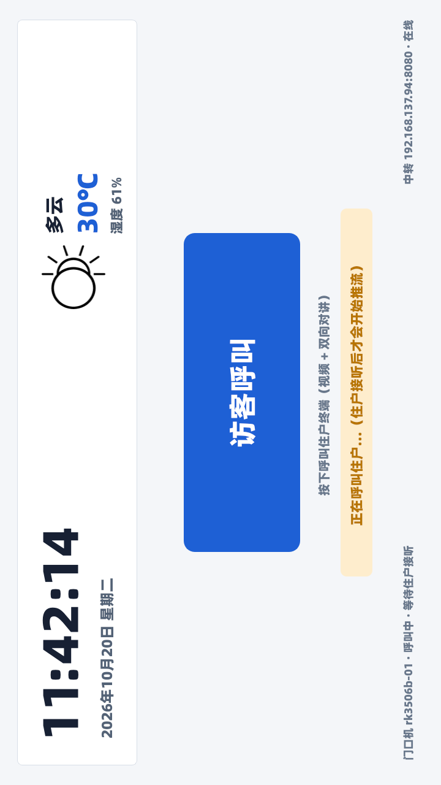
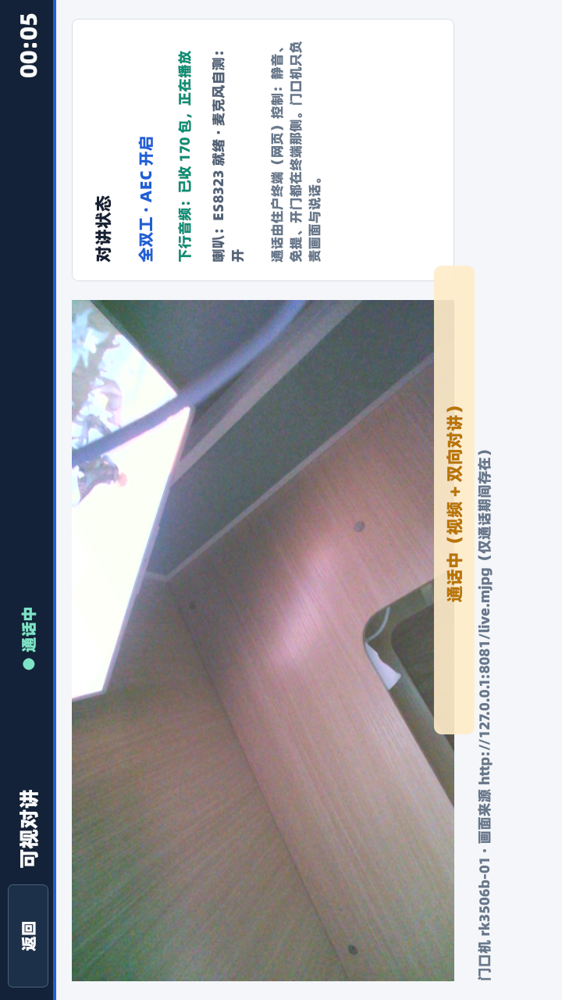
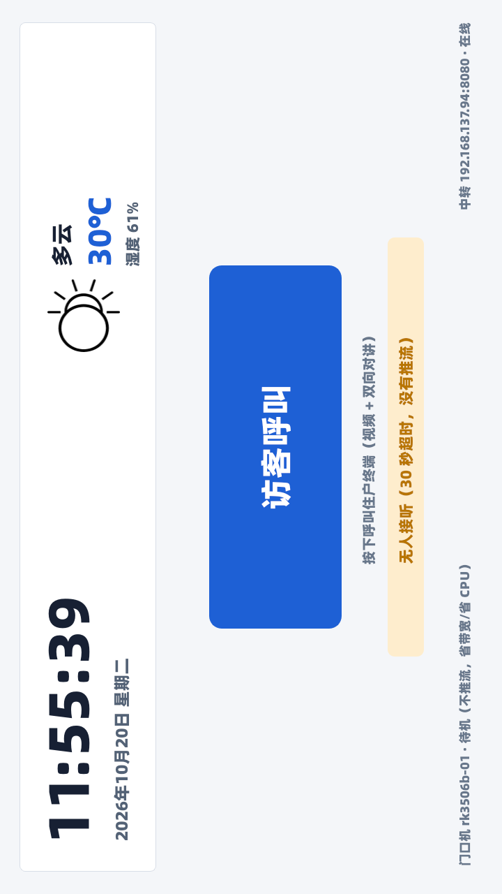
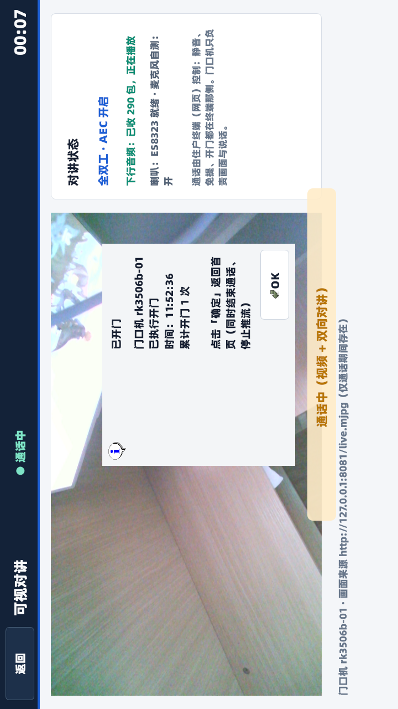
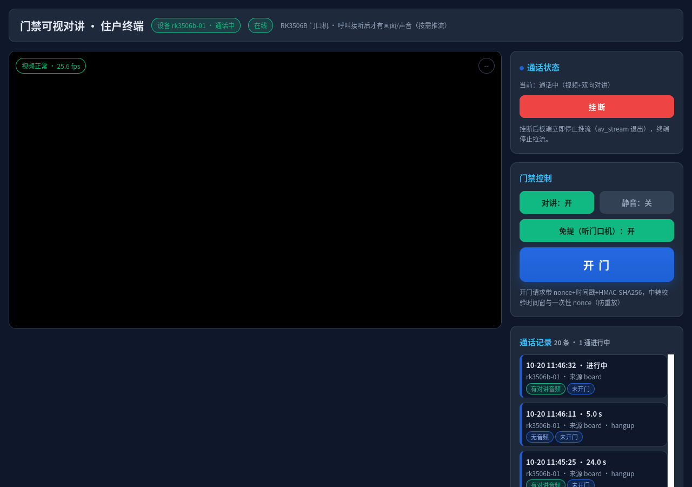
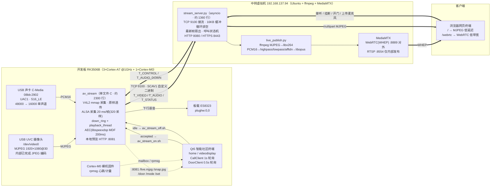

#  Visualized-intercom-intelligent-access-control · RK3506B 门禁可视对讲与智能社区终端

**在没有 GPU、没有硬件视频编码器的 RK3506B 上，用「MJPEG 原样透传 + 中转软件编码」把 1080p30 视频从 46 Mbps 压到 5 Mbps，端到端延迟 193.9 ms，支持局域网 MJPEG 与远程 WebRTC 双通道分发。**


-orange)


---

## 1. Highlights / 项目亮点

| 亮点 | 说明 |
|---|---|
| **无编码器也能出 1080p** | RK3506B 没有 GPU、没有硬件视频编码器。板端只做 V4L2 MJPEG **原样透传**（编码早在 USB 摄像头内部完成），编码下沉到中转虚拟机，用 ffmpeg/libx264 软编 H.264 High。 |
| **10 倍压缩比** | 上行 46 Mbps → 下行 4875 kbps（`-crf 28 -maxrate 5M`），画质 SSIM_Y 0.9323、PSNR_Y 38.38 dB，肉眼无可见损失。 |
| **按需推流，平时零出流** | 开机不启动采集进程；访客按「访客呼叫」→ 住户点【接听】→ 板端才开始推流；挂断即停。全板只有 `av_stream` 一个进程打开 `/dev/video0`。 |
| **WebRTC 低延迟** | `-tune zerolatency` + `sliced-threads=1` + `bframes=0` + 无 lookahead，端到端 193.9 ms（触发 → 浏览器显示，中位）。 |
| **双通道分发** | 局域网走 MJPEG（69.6 ms，零解码开销）；远程/弱网走 WebRTC WHEP（5 Mbps 即可跨公网），同一路源、两个出口。 |
| **全双工对讲 + AEC** | 上行 PCM16 16 kHz，下行经 `down_ring` 播放到 ES8323；libspeexdsp MDF 尾长 200 ms 回声消除，far-end 参考延迟由 `snd_pcm_delay()` 动态标定。 |
| **开门防重放** | HMAC-SHA256 + nonce + 时间窗（±30 s）+ 一次性 nonce，签名只在住户终端发起，板端不做签名请求。 |
| **异构多核** | 3×Cortex-A7 跑 Linux/Qt/流媒体，Cortex-M0 跑裸机固件，通过 rpmsg 上报心跳与计量。 |

---

## 2. Showcase / 效果展示

### 2.1 板端 Qt 终端

| 画面 | 说明 |
|---|---|
|  | **待机不推流**：720×1280 竖屏（weston `transform=rotate-90`，逻辑分辨率 1280×720），首页显示时间、天气、社区入口；此刻 `ps` 里没有 `av_stream`，链路零出流。 |
|  | **呼叫中**：访客按下「访客呼叫」，`CallClient` 每 1 s 轮询 `/api/callstate/<dev>`，状态为 `ringing`，界面进入倒计时。 |
|  | **对讲页通话中**：`videodisplay` 从 `127.0.0.1:8081/live.mjpg` 取画面（不抢摄像头），麦克风/免提/挂断按钮全部可用。 |
|  | **无人接听超时**：响铃 30 s 无应答 → `timeout`，全程未推流。 |
|  | **对方已拒绝**：状态 `rejected`，直接回首页，不产生任何流。 |
|  | **开门弹窗**：`/api/door` 签名校验通过 → 中转下发 `T_CONTROL{"cmd":"open"}` → 板端 `:8081/door` 被 `DoorClient` 每 0.5 s 轮询到 → 弹窗确认。 |

### 2.2 网页终端

| 画面 | 说明 |
|---|---|
|  | **呼叫弹窗**：住户打开 `http://192.168.137.94:8080/`，收到呼叫后弹出【接听】/【拒绝】。 |
|  | **通话中**：MJPEG 页直接出画（低延迟），同时显示码率、帧率、延迟读数；切到 `/webrtc` 走 H.264+Opus。 |

> 截图目录：`docs/screenshots/ondemand_20261020/`；同一目录下的 `logs/flow_accept.log`、`logs/flow_reject.log`、`logs/verify_full.log` 为端到端流程验证日志。

---

## 3. Architecture / 系统架构

### 3.1 全景图



### 3.2 数据面与控制面

| 平面 | 通道 | 载体 | 方向 |
|---|---|---|---|
| 视频上行 | TCP 9100 | `T_VIDEO=1`，载荷为摄像头原始 JPEG 帧 | 板端 → 中转 |
| 音频上行 | TCP 9100 | `T_AUDIO=2`，PCM16 S16_LE 16000 Hz 单声道，20 ms/帧 | 板端 → 中转 |
| 状态心跳 | TCP 9100 | `T_STATUS=3`，JSON（fps、帧龄、音乐/摄像头状态、uptime） | 板端 → 中转 |
| 控制下发 | TCP 9100 | `T_CONTROL=5`（`open` 等） | 中转 → 板端 |
| 语音下行 | TCP 9100 | `T_AUDIO_DOWN=6` → `down_ring` → `playback_thread` → `plughw:0,0` | 中转 → 板端 |
| 本机预览 | HTTP 8081 | `/live.mjpg` `/snap.jpg` `/door` `/mode` `/set` | 板内回环 |
| 网页与 API | HTTP 8080 / HTTPS 8443 | REST + multipart + WHEP 代理 | 浏览器 ↔ 中转 |
| 播放分发 | WebRTC 8889 | H.264 High + Opus 48 kHz | MediaMTX → 浏览器 |

### 3.3 关键设计决策

1. **编码下沉**：板端零转码，`av_stream` 只做「V4L2 mmap 取帧 → 打 TLV 头 → `send()`」。1080p30 下板端 CPU 约 3%。
2. **摄像头独占**：全板只有 `av_stream` 打开 `/dev/video0`；Qt 的 `videodisplay` 一律走 `127.0.0.1:8081`，`v4l2.cpp` 只作为中转不可达时的备用预览。
3. **单一触发源**：只有 `CallClient` 拉起流。`wd_guard.sh` 只负责「该活着的时候把它救回来 / 该停的时候只停不启」。
4. **`intentional_stop` 显式标记**：`av_stream_off.sh` 停止前写入 `/tmp/av_stream.intentional_stop`，守护看到标记就不再兜底拉起，彻底消除「挂断后被自动重启」。
5. **文件锁串行化**：`av_stream_on.sh` / `av_stream_off.sh` 用原子 `mkdir` 操作锁互斥，避免 Qt 与守护同时启动导致双实例抢 `/dev/video0`。
6. **协议自描述**：`hello` 里声明 `audio=pcm16k`、`size`、`fps`，中转据此决定音频旁路与编码参数，不改代码即可换档位。

---

## 4. Features / 功能列表

| 功能 | 状态 | 说明 |
|---|---|---|
| 1080p30 MJPEG 透传推流 | ✅ 已实现 | 板端零转码，实测上行 46–54 Mbps |
| 中转 H.264 High 软编 | ✅ 已实现 | `-crf 28 -maxrate 5M -preset superfast -tune zerolatency`，实测 4875 kbps |
| 双通道分发（MJPEG + WebRTC） | ✅ 已实现 | `/live/<dev>.mjpg` 与 `/whep/<dev>` |
| 按需推流（接听才推、挂断即停） | ✅ 已实现 | 开机不启动，挂断在 1 s 内停流 |
| 呼叫状态机 | ✅ 已实现 | `idle / ringing / accepted / rejected / timeout`，响铃 30 s、单通最长 600 s、会话态保留 8 s |
| 全双工对讲 | ✅ 已实现 | 上行 PCM16 16 kHz；下行 `T_AUDIO_DOWN` → ES8323 |
| 回声消除 AEC | ✅ 已实现 | libspeexdsp MDF，尾长 200 ms / 3200 taps，自测抑制 ≥ 20 dB |
| 下行噪声门 | ✅ 已实现 | `down_gate_should_mute()`，默认 −50 dBFS + 5 帧保持 |
| 开门鉴权 | ✅ 已实现 | HMAC-SHA256 + nonce + ±30 s 时间窗 + 一次性 nonce |
| 本机预览 HTTP | ✅ 已实现 | `:8081` 的 `/live.mjpg` `/snap.jpg` `/door` `/mode` `/set` |
| 断线自动重连 | ✅ 已实现 | 指数退避 + 热插拔检测 |
| 进程守护 | ✅ 已实现 | `S99wd_guard` + `wd_guard.sh`，只停不启 + `pause` 挂起窗口 |
| 安全重启 | ✅ 已实现 | `safe_restart_av_stream.sh`，唯一安全重启方式 |
| 时间代理 | ✅ 已实现 | 板子无 RTC 电池，开机向 `GET /api/time` 校时 |
| 天气 | ✅ 已实现 | `GET /api/weather`，中转 10 分钟缓存 |
| USB 音频模块 | ✅ 已实现 | `usbaudio_modules/` 四个 ko，vermagic 与 6.1.118 一致 |

---

## 5. Tech Stack / 技术栈

| 层次 | 技术 / 组件 | 版本或关键参数 |
|---|---|---|
| 主控 | Rockchip RK3506B | 3×Cortex-A7 + 1×Cortex-M0，无 GPU / 无硬件编码器 |
| 板卡 | 正点原子 ATK-DLRK3506B | SDK `atk_dlrk3506_linux6.1_release_v1.3.1` |
| 内核 | Linux | 6.1.118 |
| 根文件系统 | Buildroot（busybox） | init 脚本 `S47 → S49 → S98 → S99` |
| 显示 | weston | 720×1280 竖装，`transform=rotate-90` → 逻辑 1280×720 |
| 摄像头 | USB UVC | MJPEG 1920×1080@30，JPEG 编码在摄像头内部完成 |
| 音频采集 | USB 声卡 C-Media 08bb:2902 | UAC1，S16_LE，仅 44100/48000 |
| 音频播放 | 板载 ES8323 | ALSA `plughw:0,0` |
| 设备端程序 | C（单文件） | `av_stream.c` 约 2300 行，`libjpeg`/`libturbojpeg`/`libasound`/`libspeexdsp` |
| 图形终端 | C++ / Qt5 | `.pro` 工程，`home` / `videodisplay` / `call_client` / `door_client` / `weather_client` |
| 中转服务 | Python3 asyncio | `stream_server.py` 约 1360 行，零第三方依赖 |
| 转码 | ffmpeg + libx264 + libopus | `-preset superfast -tune zerolatency -x264-params sliced-threads=1` |
| 网关 | MediaMTX | WebRTC(WHEP) 8889 对外、RTSP 8554 仅内部发布 |
| 前端 | 原生 HTML/JS | `video_surveillance/web/index.html`，MJPEG + WHEP |
| 数据库 | SQLite | `/userdata/smart_community/intell_com.db` |
| 交叉编译 | SDK buildroot 工具链 | `arm-buildroot-linux-gnueabihf-gcc`、host 版 `qmake` |

---

## 6. Quick Start / 快速开始

### 6.1 硬件清单

| 部件 | 型号 | 备注 |
|---|---|---|
| 主控板 | ATK-DLRK3506B（RK3506B） | 3×Cortex-A7 + 1×Cortex-M0 |
| 屏幕 | 720×1280 MIPI/DPI 竖屏 | weston `transform=rotate-90` |
| 摄像头 | USB UVC 摄像头 | 必须支持 MJPEG 输出（`1920x1080@30`） |
| 麦克风 | USB 声卡 C-Media 08bb:2902 | UAC1，S16_LE，44100/48000 |
| 喇叭 | 板载 ES8323 | `plughw:0,0` |
| 中转主机 | x86_64 / Ubuntu 20.04（4 vCPU 起） | 装 ffmpeg + MediaMTX |
| 网络 | 千兆交换机 / 直连 | 192.168.137.0/24 |

> 上行 46 Mbps 必须千兆链路。百兆环境请把 `SIZE` 降到 `1280x720`。

### 6.2 环境要求

```bash
# 中转 / 编译机（Ubuntu 20.04 及以上）
sudo apt update
sudo apt install -y build-essential python3 ffmpeg adb

# 设备端交叉工具链随 SDK 提供
export SDK=$HOME/atk_dlrk3506_linux6.1_release_v1.3.1
ls $SDK/buildroot/output/alientek_rk3506/host/bin/arm-buildroot-linux-gnueabihf-gcc
```

### 6.3 板端编译与部署

```bash
# ① 交叉编译 av_stream（在 VM 里执行）
cd ~/video_surveillance
bash scripts/build_device.sh
file build/av_stream          # 应显示 ARM, EABI5

# ② 整体部署「按需推流」版本到板子（adb push + 安装 init 脚本 + 重启应用）
bash scripts/deploy_ondemand.sh

# ③ 只做成开机自启（不含 Qt 应用）
bash scripts/install_av_on_board.sh
```

```bash
# ④ 板端手动验证（必须带 FORCE=1，否则开机阶段会被挡掉）
FORCE=1 /etc/init.d/S98av_stream start
/etc/init.d/S98av_stream status
curl -s http://127.0.0.1:8081/snap.jpg -o /tmp/snap.jpg
```

```bash
# ⑤ 编译并安装 Qt 智能社区终端
cd ~/rk3506b
bash scripts/build_app.sh
bash scripts/install_on_board.sh
```

```bash
# ⑥ 编译内核模块与 M0 固件
bash scripts/build_module.sh
bash scripts/build_mcu.sh
```

### 6.4 中转部署

```bash
# ① 安装 MediaMTX
cd ~/video_surveillance
bash scripts/install_mediamtx.sh

# ② 一键起全套：MediaMTX(:8889) + 中转服务(:9100/:8080) + ffmpeg 转码发布
bash scripts/run_server_vm.sh

# 常用运维
bash scripts/run_server_vm.sh status
bash scripts/run_server_vm.sh stop
tail -f ~/video_surveillance/server.log
```

可调环境变量：

```bash
SC_PUBLISH=1                  # 开关 H.264 转码发布
SC_PUBLISH_BR=5M              # 转码码率上限
SC_PUBLISH_CRF=28             # CRF 质量档
SC_PUBLISH_PRESET=superfast   # x264 档位
SC_PUBLISH_PROFILE=high       # H.264 profile
SC_PUBLISH_FPS=30             # 发布帧率
SC_RING_TIMEOUT=30            # 响铃超时（秒）
SC_CALL_MAX_SEC=600           # 单通最长时长（秒）
```

### 7.5 网页访问

| 入口 | 地址 | 用途 |
|---|---|---|
| MJPEG 低延迟页 | `http://192.168.137.94:8080/` | 局域网调试、呼叫弹窗、开门 |
| WebRTC 低带宽页 | `http://192.168.137.94:8080/webrtc` | 远程播放（H.264 + Opus） |
| 单路 MJPEG | `http://192.168.137.94:8080/live/<dev>.mjpg` | 嵌第三方页面 |
| 抓图 | `http://192.168.137.94:8080/snapshot/<dev>.jpg` | 一次性截图 |
| WHEP 信令 | `POST http://192.168.137.94:8080/whep/<dev>` | 同源代理，https 页面也可用 |
| 板端本机预览 | `http://192.168.137.85:8081/live.mjpg` | 不经网络，延迟最低 |

> 平时设备不推流时，`/api/devices` 为空、MediaMTX 无路径，这是**预期状态**，不是故障。

---

## 7. Usage / 使用说明

### 7.1 呼叫 → 接听 → 通话

```text
访客                                  板端 Qt 终端                        中转服务                      住户网页
 │                                        │                                  │                            │
 │ 按【访客呼叫】                          │                                  │                            │
 ├───────────────────────────────────────>│                                  │                            │
 │                                        │ POST /api/call/start?dev=rk3506b-01                            │
 │                                        ├─────────────────────────────────>│ 状态 → ringing              │
 │                                        │                                  ├───────────────────────────>│ 弹窗【接听】/【拒绝】
 │                                        │ CallClient 每 1s 轮询            │                            │
 │                                        │ GET /api/callstate/rk3506b-01    │                            │
 │                                        ├─────────────────────────────────>│                            │
 │                                        │                                  │<─── POST /api/call/<dev>/accept
 │                                        │<─ accepted ──────────────────────┤                            │
 │                                        │                                  │                            │
 │                                        │ QProcess::startDetached          │                            │
 │                                        │   /userdata/av_stream_on.sh      │                            │
 │                                        │ → FORCE=1 S98av_stream start     │                            │
 │                                        │ → av_stream 打开 /dev/video0     │                            │
 │                                        │                                  │                            │
 │                                        │ ══ TCP 9100 · T_VIDEO / T_AUDIO ═>│                            │
 │                                        │                                  │ ffmpeg 软编 H.264+Opus      │
 │                                        │<═ TCP 9100 · T_AUDIO_DOWN ═══════┤ → MediaMTX :8554 → :8889   │
 │                                        │                                  ├─── MJPEG / WebRTC ────────>│ 看到画面听到声音
 │                                        │                                  │                            │
 │                                        │ ══ 挂断：POST /api/call/<dev>/hangup ═════════════════════════>│
 │                                        │<─ idle ──────────────────────────┤                            │
 │                                        │ /userdata/av_stream_off.sh       │                            │
 │                                        │ → 写 /tmp/av_stream.intentional_stop                          │
 │                                        │ → 停 av_stream（≤1s）            │                            │
```

关键时序指标：响铃超时 **30 s**；单通最长 **600 s**；会话态保留 **8 s**；挂断 → 停流 **≤1 s**。

### 7.2 开门流程

```text
住户网页 ──POST /api/door {dev, ts, nonce, sig=HMAC-SHA256(key, dev|ts|nonce)}──> 中转
                                                                                    │
                            校验：±30s 时间窗 + nonce 未用过（一次性） ───────────────┤
                                                                                    │
                                            T_CONTROL{"cmd":"open"} ────────────────> 板端 av_stream
                                                                                    │
                                           GET http://127.0.0.1:8081/door <──────────┤ 记录事件
                                                                                    │
板端 DoorClient 每 0.5s 轮询 ──────────────────────────────────────────────────────> 弹窗「已开门」→ 回首页
```

- 签名密钥：板端 `board_config.h` 的 `BOARD_DOOR_KEY` 与中转 `SC_DOOR_KEY` 必须一致。
- 板端**不做**签名请求，只被动接收并弹窗提示；签名只在住户终端发起。
- 重放防护三件套：时间窗（±30 s）+ 一次性 nonce + HMAC-SHA256。

### 7.3 日常运维命令

```bash
# 板端：查看状态与日志
/etc/init.d/S98av_stream status
tail -f /userdata/av_stream.log
tail -f /userdata/av_stream_switch.log

# 板端：唯一安全的重启方式
/userdata/safe_restart_av_stream.sh

# 板端：手动起流 / 停流
/userdata/av_stream_on.sh
/userdata/av_stream_off.sh

# 中转：查呼叫状态与设备列表
curl -s http://192.168.137.94:8080/api/callstate/rk3506b-01
curl -s http://192.168.137.94:8080/api/devices
curl -s http://192.168.137.94:8080/api/status
```

> 千万不要用 `killall av_stream` 之后直接 `S98av_stream start` 来「重启」：必须走 `safe_restart_av_stream.sh`，它会先 `touch /userdata/wd_guard.pause` 挂起守护，避免双实例抢 `/dev/video0`。

---

## 8. Performance / 性能数据

### 8.1 视频链路

| 指标 | 数值 | 测量方式 |
|---|---|---|
| 上行码率（板端 → 中转） | 46 Mbps（实测区间 46–54 Mbps） | `T_STATUS` 帧龄 + 中转入向字节差分 |
| 下行码率（中转 → WebRTC） | **4875 kbps** | MediaMTX `inbound_kbps` 增量 |
| 压缩比 | **约 10 倍** | 46 / 4.875 |
| 画质 | SSIM_Y **0.932342**、PSNR_Y **38.3764 dB** | 57.4 s / 1722 帧真实录像 A/B/C 三组 14 个编码点 |
| 上行分辨率/帧率 | 1920×1080 @ 30 fps | `v4l2-ctl --list-formats-ext` |
| 板端 CPU（MJPEG 透传） | **约 3%**（load 0.08） | `/proc/stat` + `/proc/<pid>/stat` tick 差分 |

### 8.2 端到端延迟

| 路径 | 端到端延迟（中位） | 说明 |
|---|---|---|
| **WebRTC**（触发 → 浏览器显示） | **193.9 ms** | 4 轮中位，min 175.8 / max 197.6，时钟偏移 ±21 ms |
| **MJPEG**（触发 → 浏览器显示） | **69.6 ms** | 局域网低延迟路径 |

延迟分段（中转侧可打点部分）：

| 段 | 中位 |
|---|---|
| 触发（v4l2 亮度台阶）→ 中转入队 | 55.4 ms（净 ≈35 ms，已扣 adb 20 ms） |
| 中转入队 → MJPEG 出口 | 5.5 ms |
| MJPEG 出口 → RTSP 出口（转码 + 分发） | 89.1 ms |

延迟压制的三个开关：`-tune zerolatency`、`-x264-params sliced-threads=1`（去掉 x264 帧级多线程攒帧）、`bframes=0` + 无 lookahead。

### 8.3 并发与资源

| 场景 | 客户端帧率 | 中转整机 CPU（均/峰） | 设备侧 fps |
|---|---|---|---|
| 1 路（MJPEG + WebRTC） | 29.93–29.98 fps，0 卡顿 | — | ≈30 |
| 4 路（4×MJPEG + 4×WebRTC） | 29.94–29.95 fps，0 卡顿，最大帧间隔 58–73 ms | **26.8% / 42.6%** | 30.0 |
| 8 路（8×MJPEG + 8×WebRTC） | 29.94–29.98 fps，0 卡顿，最大帧间隔 82 ms | **31.2% / 42.1%** | 30.1 |

- 转码进程恒定约占 **0.73 个核**（72–78% 单核）。
- 8 路也只占 4 核的 31.2%，**瓶颈不在中转 CPU**，而在测试机侧 Python 客户端的解析吞吐与宿主机网络栈。
- 内存：`stream_server` RSS ≈23 MB；单路 ffmpeg ≈97–145 MB。

### 8.4 音频链路

| 指标 | 数值 |
|---|---|
| 上行采样 | PCM16 S16_LE 16000 Hz 单声道，20 ms/帧（320 采样） |
| 下行播放 | ALSA period 640 帧（40 ms）/ buffer 1920 帧（120 ms） |
| AEC | libspeexdsp MDF，尾长 200 ms / 3200 taps，自测抑制 ≥20 dB |
| 下行噪声门 | −50 dBFS，5 帧保持 |

---

## 9. Board Adaptation / 板级适配要点

所有硬件差异集中在 `rk3506b/app/board_config.h` 一个文件，换板只改它：

| 宏 | 值 | 作用 |
|---|---|---|
| `BOARD_DATA_DIR` | `/userdata/smart_community` | 运行期数据（SQLite、日志）统一放独立分区 |
| `BOARD_VIDEO_DEV` | `/dev/video0` | USB UVC 摄像头 |
| `BOARD_STREAM_HOST` | `192.168.137.94:8080` | 中转 HTTP 根 |
| `BOARD_STREAM_DEV` | `rk3506b-01` | 设备号（与 `/etc/default/av_stream` 的 `DEVICE_ID` 一致） |
| `BOARD_STREAM_LOCAL` | `127.0.0.1:8081` | 板端本机预览（延迟最低） |
| `BOARD_DOOR_KEY` | 共享密钥 | 与中转 `SC_DOOR_KEY` 一致 |
| `BOARD_WEATHER_CITY` | `Shenzhen` | wttr.in 英文城市名 |

启动顺序（`/etc/init.d`）：

```text
S47wifi_smart_community   # 连 WiFi + 校时（timesync.sh）
S49weston                 # 起显示合成器（rotate-90）
S98av_stream              # 推流启停（平时不自启，FORCE=1 才起）
S99smart_community        # 起 Qt 智能社区终端
S99wd_guard               # 起守护（只停不启）
```

---


## 10. Known Limitations / 已知限制

| 限制 | 影响 | 缓解方式 |
|---|---|---|
| **无 GPU、无硬件编码器** | 板端无法自行产出 H.264/H.265 | 编码强制下沉到中转 ffmpeg（本项目的核心设计） |
| **上行 MJPEG 46 Mbps** | 百兆链路必然拥塞，无法跨公网 | 必须千兆内网；必要时 `SIZE=1280x720` 或 `FPS=15` |
| **摄像头独占** | 第二个进程打开 `/dev/video0` 会失败或抢流 | 全板只有 `av_stream` 打开；Qt 一律走 `:8081` |
| **中转软编吃 CPU** | 单路 ffmpeg 占约 0.73 个核 | 4–8 路仍可跑（整机 26.8%–31.2%）；更多路需加核或硬件编码卡 |
| **USB 声卡仅 44100/48000** | 无法直接 16000 采集 | 走 ALSA `plug` 插件重采样到 16000 |
| **PCM16 上行固定 16 kHz 单声道** | 音乐类内容音质受限 | 语音对讲场景足够；带宽约 256 kbps |
| **板子无 RTC 电池** | 重启回到 1970 | 开机向 `GET /api/time` 校时（`timesync.sh`） |
| **A7→M0 下行通道** | 以 M0→A7 上报为主 | M0 每 5 s 上报心跳与计量，A7 侧 rpmsg 端点绑定 |
| **单设备号单路** | 一台板卡对应一个 `DEVICE_ID` | 多台板卡用不同 `DEVICE_ID`，中转按设备号分路径 |
| **WebRTC 需 ICE 可达** | NAT/防火墙可能阻断 UDP 8189 | 已开 `webrtcLocalTCPAddress` 走 TCP 候选兜底 |

---

## 11. License / 许可证

```text
MIT License

Copyright (c) 2026 Arm-linux-Smart-Community

Permission is hereby granted, free of charge, to any person obtaining a copy
of this software and associated documentation files (the "Software"), to deal
in the Software without restriction, including without limitation the rights
to use, copy, modify, merge, publish, distribute, sublicense, and/or sell
copies of the Software, and to permit persons to whom the Software is
furnished to do so, subject to the following conditions:

The above copyright notice and this permission notice shall be included in all
copies or substantial portions of the Software.

THE SOFTWARE IS PROVIDED "AS IS", WITHOUT WARRANTY OF ANY KIND, EXPRESS OR
IMPLIED, INCLUDING BUT NOT LIMITED TO THE WARRANTIES OF MERCHANTABILITY,
FITNESS FOR A PARTICULAR PURPOSE AND NONINFRINGEMENT. IN NO EVENT SHALL THE
AUTHORS OR COPYRIGHT HOLDERS BE LIABLE FOR ANY CLAIM, DAMAGES OR OTHER
LIABILITY, WHETHER IN AN ACTION OF CONTRACT, TORT OR OTHERWISE, ARISING FROM,
OUT OF OR IN CONNECTION WITH THE SOFTWARE OR THE USE OR OTHER DEALINGS IN THE
SOFTWARE.
```

---

## Appendix A · SCAV1 协议速查

```text
包格式（12 字节头 + 载荷）：
┌──────────┬──────────┬────────┬───────┬───────────────┐
│ magic(4) │ type(1)  │ flags  │ seq   │ len(4)        │
│ "SCAV"   │ 1..6     │ (1)    │ (2)   │ 载荷长度      │
└──────────┴──────────┴────────┴───────┴───────────────┘

type 定义：
  1 = T_VIDEO        摄像头原始 JPEG（原样透传，不转码）
  2 = T_AUDIO        PCM16 S16_LE 16000 单声道，20ms/帧（320 采样）
  3 = T_STATUS       JSON 心跳（fps / 帧龄 / uptime / 设备状态）
  5 = T_CONTROL      控制指令（open 等）
  6 = T_AUDIO_DOWN   下行语音 → down_ring → playback_thread → plughw:0,0
```

## Appendix B · HTTP / REST API 速查

| 方法 | 路径 | 用途 |
|---|---|---|
| GET | `/` | 网页终端（MJPEG 低延迟页） |
| GET | `/webrtc` | 网页终端（WebRTC 低带宽页） |
| GET | `/live/<dev>.mjpg` | 实时 MJPEG 视频流 |
| GET | `/live/<dev>.alaw` | 实时音频流 |
| GET | `/snapshot/<dev>.jpg` | 抓一张当前画面 |
| POST | `/whep/<dev>` | WHEP 信令同源代理 |
| GET | `/api/callstate/<dev>` | 单台设备呼叫状态（JSON） |
| GET | `/api/callstate` | 所有设备呼叫状态 |
| POST | `/api/call/start?dev=<dev>` | 访客呼叫，状态 → `ringing` |
| POST | `/api/call/<dev>/accept` | 住户接听，状态 → `accepted`（板端开始推流） |
| POST | `/api/call/<dev>/reject` | 住户拒绝，状态 → `rejected`（全程不推流） |
| POST | `/api/call/<dev>/hangup` | 挂断，状态 → `idle`（板端停流） |
| POST | `/api/talk` | 住户麦克风 PCM16（16 kHz 单声道）上传 |
| POST | `/api/door` | 开门（HMAC-SHA256 + nonce + ts） |
| GET | `/api/devices` | 在线设备列表 |
| GET | `/api/calls` | 通话记录 |
| GET | `/api/time` | 时间代理（板端校时） |
| GET | `/api/weather` | 天气代理（10 分钟缓存） |
| GET | `/api/status` | 简化状态（设备在线 / 通话中 / 最近开门） |

## Appendix C · 端口一览

| 端口 | 进程 | 说明 |
|---|---|---|
| 9100/TCP | `stream_server.py` | 板端上行推流入口（SCAV1） |
| 8080/HTTP | `stream_server.py` | 网页与 REST API |
| 8443/HTTPS | `stream_server.py` | 安全入口（WHEP 走同源代理） |
| 8081/HTTP | `av_stream`（板端） | 本机预览 `/live.mjpg` `/snap.jpg` `/door` `/mode` `/set` |
| 8554/RTSP | MediaMTX | **仅内部发布通道**（ffmpeg → MediaMTX） |
| 8889/HTTP | MediaMTX | WebRTC WHEP，唯一对外播放入口 |
| 8189/UDP+TCP | MediaMTX | WebRTC ICE 候选 |
| 9997/HTTP | MediaMTX | 管理 API（查流是否在推） |
